# Parcel Desk 社區包裹代收系統

[](https://github.com/hn83320589/Parcel-Desk/actions/workflows/ci.yml)
[](LICENSE)

約 400 戶社區大樓的包裹代收 API：管理員登記包裹、系統產生領取碼並通知住戶，住戶憑領取碼（或由有效代領人）到 A / B 棟櫃台簽收，逾期自動提醒，管委會可查月報與匯出 CSV。

- Python 3.12+、FastAPI、SQLAlchemy 2.x、Alembic、SQLite（檔案型）
- 沒有前端，用 Swagger UI（`/docs`）操作
- 設計說明見 [`docs/DESIGN.md`](docs/DESIGN.md)，測試報告見 [`docs/TEST_REPORT.md`](docs/TEST_REPORT.md)

## 啟動方式

系統有兩種模式，使用**不同的資料庫檔案**，示範資料不會混入正式資料：

| 模式 | 指令 | 資料庫 | 用途 |
|---|---|---|---|
| **示範** | `uv run parcel-desk demo` | `data/demo.db` | 一個指令啟動並載入示範資料，用於評估與驗收 |
| **正式** | `uv run parcel-desk` | `data/parcel_desk.db` | 實際上線。不載入任何示範資料 |

```bash
# 安裝 uv（只需一次）
#   macOS：  brew install uv   或   curl -LsSf https://astral.sh/uv/install.sh | sh
#   Windows：powershell -ExecutionPolicy ByPass -c "irm https://astral.sh/uv/install.ps1 | iex"

uv sync                  # 依 uv.lock 安裝鎖定版本的相依套件
uv run parcel-desk demo  # 示範模式：建立示範資料庫 → 載入示範資料 → 啟動 API
```

打開 <http://localhost:8000/docs>，點右上角 **Authorize**，輸入下方的示範帳號就能登入。
兩個櫃台的電腦透過區域網路連到 `http://<管理室電腦 IP>:8000/docs`。Windows 防火牆需要放行 8000 port。

### 正式上線

```bash
uv run parcel-desk
```

第一次啟動時只會建立一個管委會帳號 `admin`，並在終端機**顯示一次性的隨機密碼**：

```
============================================================
  首次啟動：已建立管委會帳號
    帳號：admin
    密碼：Xr7qVh2LmP9sKd4T      ← 範例，實際為隨機產生
  此密碼只會顯示這一次。登入後必須先呼叫
  POST /auth/change-password 修改密碼，才能使用其他功能。
============================================================
```

用這組密碼登入後，在修改密碼之前，除了 `GET /auth/me` 與 `POST /auth/change-password` 以外的 API 都會回 `403 PASSWORD_CHANGE_REQUIRED`。改完密碼後，再用 `POST /units`、`POST /users` 建立戶別、管理員與住戶帳號。

### 使用 pip

```bash
python -m venv .venv
.venv\Scripts\activate          # macOS / Linux：source .venv/bin/activate
pip install -e .
parcel-desk
```

> pip 不會讀取 `uv.lock`，安裝的是符合 `pyproject.toml` 範圍的最新版。需要完全一致的鎖定版本時請使用 uv。

### 其他指令

| 指令 | 說明 |
|---|---|
| `uv run parcel-desk` | 正式模式啟動（等同 `parcel-desk serve`） |
| `uv run parcel-desk demo` | 示範模式啟動；示範資料庫已存在時沿用 |
| `uv run parcel-desk demo --reset` | 重建示範資料庫後啟動 |
| `uv run parcel-desk serve --port 9000` | 指定 port（`demo` 也適用） |
| `uv run parcel-desk migrate` | 只對正式資料庫執行 migration |
| `uv run alembic upgrade head` | 直接用 Alembic 從零建立正式資料庫 |
| `uv run pytest` | 執行測試 |
| `uv run pytest --cov=parcel_desk` | 執行測試並顯示覆蓋率 |
| `uv run python scripts/e2e_acceptance.py` | 對啟動中的 API 逐項驗證驗收標準 |
| `uv run ruff check . && uv run ruff format --check .` | lint / format 檢查 |

### 設定（環境變數或 `.env`）

| 變數 | 預設值 | 說明 |
|---|---|---|
| `PARCEL_DATABASE_PATH` | `data/parcel_desk.db` | 正式資料庫位置（`data/` 已在 .gitignore） |
| `PARCEL_DEMO_DATABASE_PATH` | `data/demo.db` | 示範資料庫位置 |
| `PARCEL_JWT_SECRET` | 無（自動產生） | 未設定時，首次啟動隨機產生，存到 `<資料庫檔名>.jwt_secret`（例如 `data/parcel_desk.db.jwt_secret`）。自行設定時至少 32 個字元 |
| `PARCEL_JWT_EXPIRE_MINUTES` | `720` | 登入效期（一個班次 12 小時） |
| `PARCEL_HOST` / `PARCEL_PORT` | `0.0.0.0` / `8000` | 監聽位址 |
| `PARCEL_SCHEDULER_ENABLED` | `true` | 是否啟用內嵌排程 |
| `PARCEL_REMINDER_INTERVAL_MINUTES` | `10` | 逾期檢查間隔 |

## 示範帳號（僅限示範模式）

以下帳號只存在於 `parcel-desk demo` 的示範資料庫。正式資料庫中**不存在**這些帳號。

| 角色 | 帳號 | 密碼 | 說明 |
|---|---|---|---|
| 管委會 admin | `admin` | `admin1234` | |
| 管理員 staff | `staff_a` | `staff1234` | A 棟櫃台 |
| 管理員 staff | `staff_b` | `staff1234` | B 棟櫃台 |
| 住戶 resident | `a12f3_1`、`a12f3_2` | `resident1234` | A-12F-3 的住戶 |

住戶帳號的規則是「棟別小寫 + 樓層 + f + 號 + _序號」，例如 B-11F-2 的第一位住戶是 `b11f2_1`，密碼一律 `resident1234`。

示範資料內容：A、B 兩棟，各 10–12F × 1–4 號，共 **24 戶**，每戶 1–3 位住戶；**70 件**包裹，涵蓋待領、已簽收（含代領）、退回、遺失。另外刻意放了以下示範資料：

- A-12F-3：一般與大型包裹各一件逾期中；約 1.5 小時前在 10 分鐘內連續登記的 3 件，合併成 1 則通知
- 冷藏包裹：一件已發 24 小時提醒、一件已標示「需處理」
- 代領人：有效、已過期、已撤銷三種都有

示範資料會依時間順序重演過去 40 天的作業，通知、提醒、簽收紀錄都是走真正的 service 流程產生的，不是直接塞進資料表。

建置是**原子化**的：先在暫存檔 `demo.db.building` 完成 migration 與 seed，全部成功後才改名成 `demo.db`。建置途中被中斷時不會留下半套資料，下次啟動會清掉暫存檔重新建置。

## 操作示範（Swagger UI）

以下截圖是在示範模式（`parcel-desk demo`）中，從 Swagger UI 實際操作的畫面。為了不在文件中露出 token，截圖隱藏了 curl 指令區塊。

### 1. 開啟 Swagger UI

啟動後打開 <http://localhost:8000/docs>，可以看到依功能分組的所有 API。右側有鎖頭圖示的端點需要先登入。

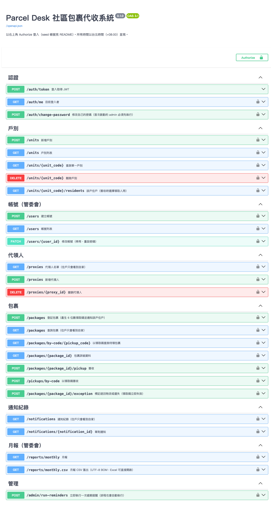

### 2. 登入

點右上角 **Authorize**，輸入 username 與 password（`client_id`、`client_secret` 留空），按 **Authorize**。出現 *Authorized* 就代表登入成功，之後所有請求都會自動帶上 JWT。要切換角色時，先按 **Logout** 再重新登入。

| 輸入帳號密碼 | 登入成功 |
|---|---|
| 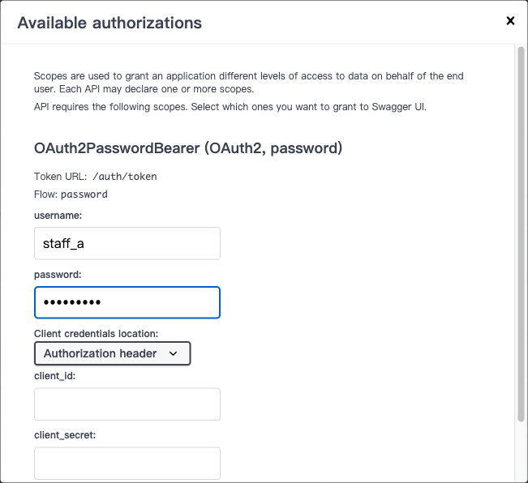 | 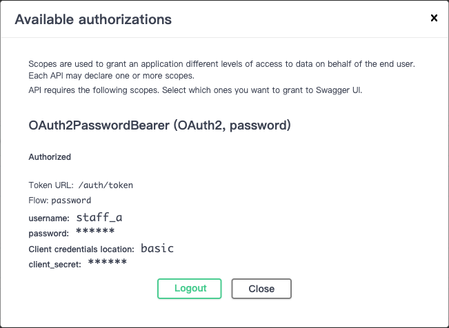 |

### 3. 管理員登記包裹（`staff_a`）

展開 `POST /packages`，點 **Try it out**，填入戶號、物流商、類型後按 **Execute**。回應 `201`，`pickup_code` 就是 6 位數領取碼。

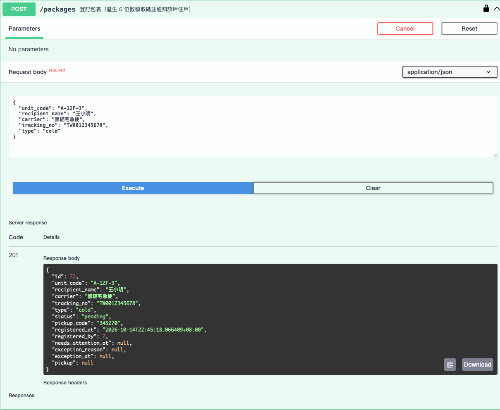

戶號格式錯誤時回 `422`，`loc` 指出是 `body` 裡的 `unit_code` 欄位：

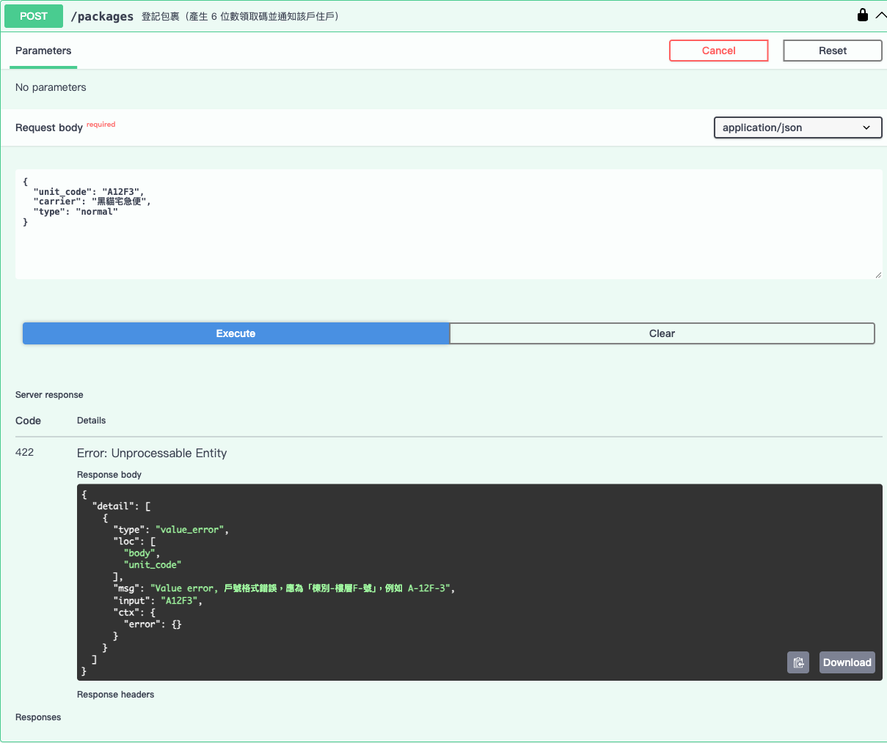

### 4. 簽收（`staff_a`）

1. 用 `GET /units/{unit_code}/residents` 查出該戶住戶，取得領取人的 `id`。代領的話則用 `GET /proxies?unit_code=...&only_valid=true` 取得代領人 `id`。

   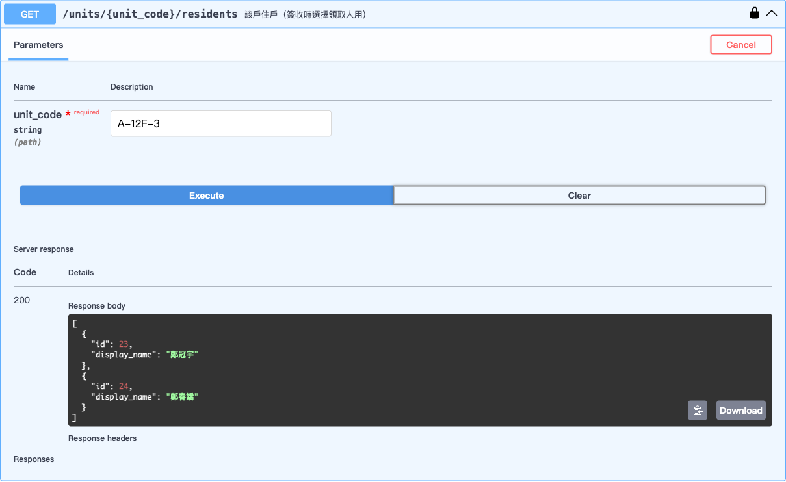

2. 用 `POST /pickups/by-code` 輸入領取碼、櫃台（`A` / `B`）與領取人後簽收。回應中的 `pickup` 記錄了領取人、經手管理員（`staff_id`）、櫃台與時間。

   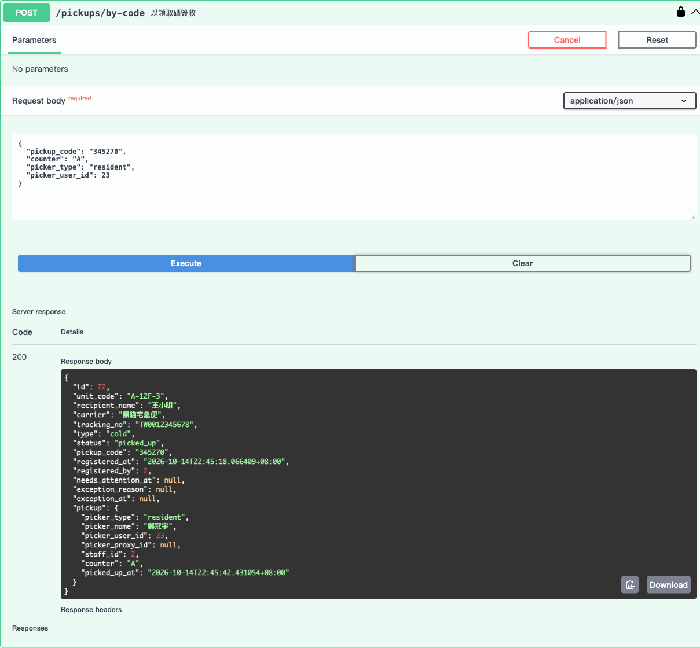

3. 同一個領取碼再簽收一次會回 `409`，原本的簽收紀錄不變：

   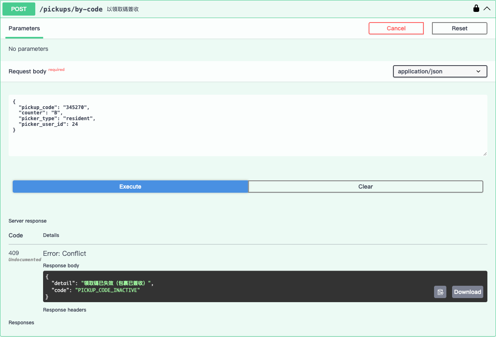

4. 選擇已過期的代領人回 `403`：

   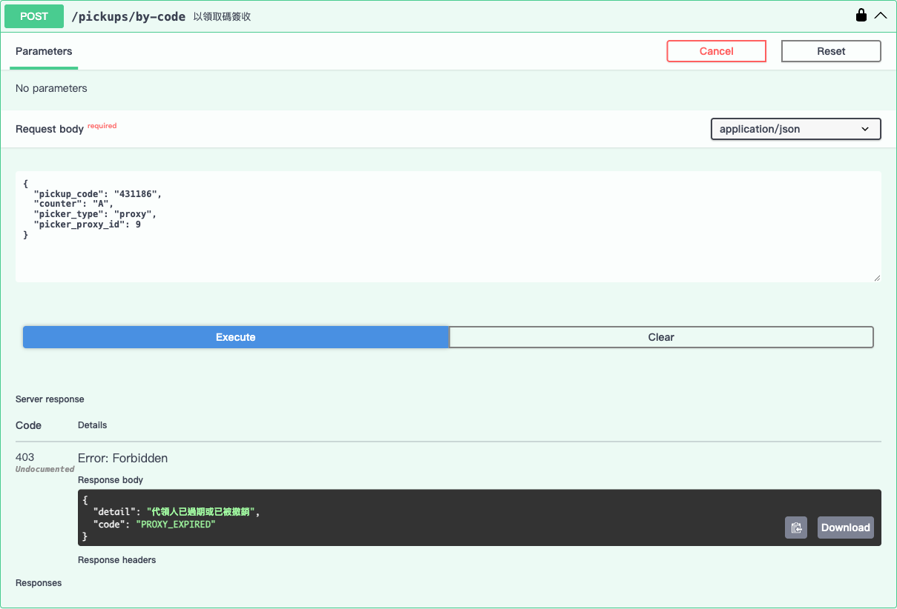

### 5. 住戶查看通知與包裹（`a12f3_1`）

以住戶身分執行 `GET /notifications`。同一戶在 10 分鐘內登記的包裹會合併成一則通知，內容列出每件的領取碼：

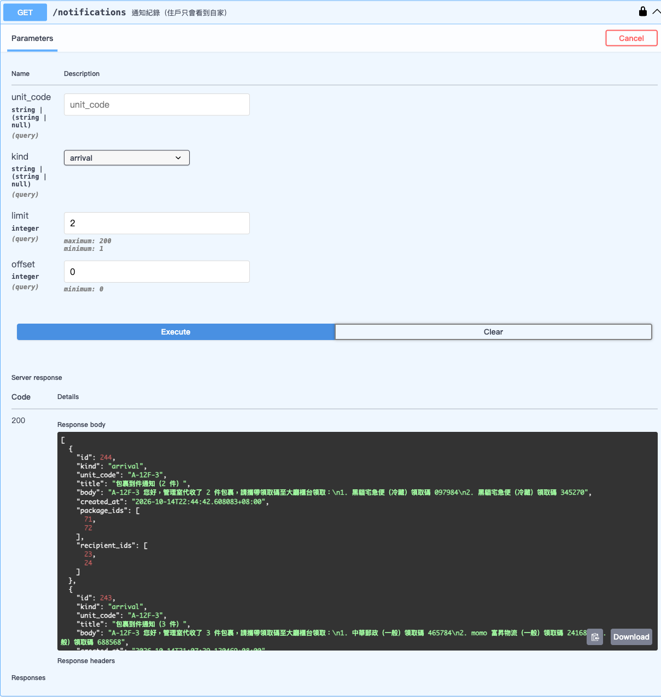

住戶查詢其他戶的包裹回 `404`：

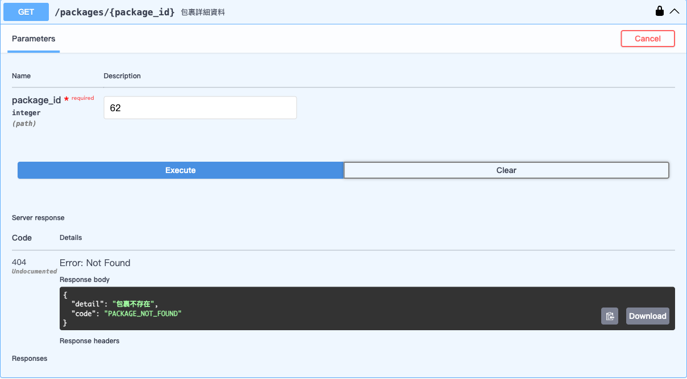

### 6. 管委會查詢（`admin`）

`GET /reports/monthly.csv?month=2026-10` 匯出月報，在 Swagger 中按 **Download file** 下載。檔案是 UTF-8 with BOM，Excel 直接開啟中文不會亂碼。`GET /reports/monthly` 則回傳同樣內容的 JSON。

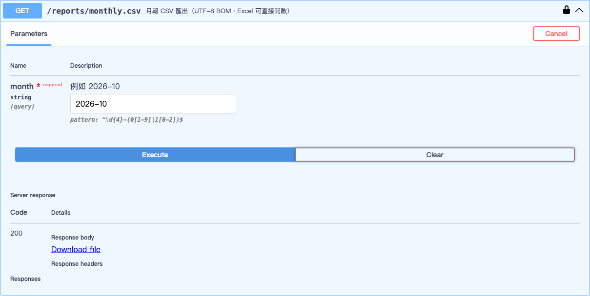

下載的 CSV 直接用 Microsoft Excel（macOS）雙擊開啟，中文表頭與「合計」列都正確顯示：

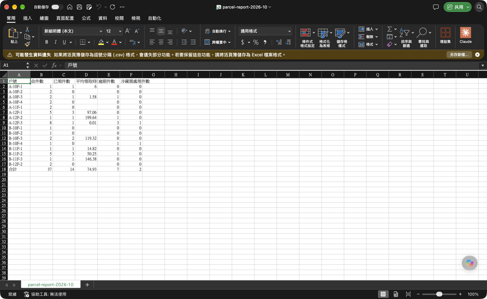

`GET /packages?needs_attention=true` 列出超過 48 小時未領、被標示「需處理」的冷藏包裹：

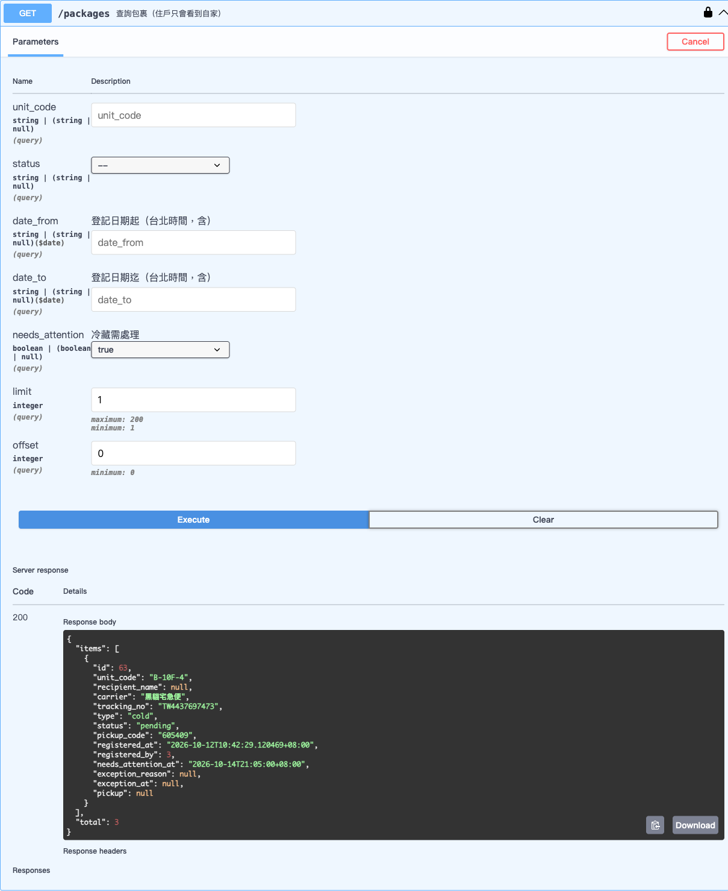

## API 一覽與權限

管委會（admin）擁有管理員（staff）的所有權限，因為管委會也在現場作業。

| Method | Path | admin | staff | resident |
|---|---|:-:|:-:|:-:|
| POST | `/auth/token` 登入（OAuth2 form） | ✓ | ✓ | ✓ |
| GET | `/auth/me` | ✓ | ✓ | ✓ |
| POST | `/auth/change-password` 修改自己的密碼 | ✓ | ✓ | ✓ |
| POST / DELETE | `/units`、`/units/{unit_code}` 新增 / 刪除戶別 | ✓ | | |
| GET | `/units`、`/units/{unit_code}` | ✓ | ✓ | |
| GET | `/units/{unit_code}/residents` 住戶名單（簽收時選領取人） | ✓ | ✓ | 自家 |
| POST / GET / PATCH | `/users` 建立帳號、停用、重設密碼 | ✓ | | |
| GET | `/proxies` 代領人名單（`only_valid=true` 只列有效者） | ✓ | ✓ | 自家 |
| POST / DELETE | `/proxies`、`/proxies/{id}` 新增 / 撤銷代領人 | ✓ | | 自家 |
| POST | `/packages` 登記包裹 | ✓ | ✓ | |
| GET | `/packages` 依 `unit_code`、`status`、`date_from`、`date_to`、`needs_attention` 查詢，分頁 | 全部 | 全部 | 自家 |
| GET | `/packages/{id}` | ✓ | ✓ | 自家 |
| GET | `/packages/by-code/{pickup_code}` 用領取碼找待領包裹 | ✓ | ✓ | |
| POST | `/packages/{id}/pickup` 簽收 | ✓ | ✓ | |
| POST | `/pickups/by-code` 用領取碼簽收 | ✓ | ✓ | |
| POST | `/packages/{id}/exception` 標記退回 / 遺失（必填原因） | ✓ | ✓ | |
| GET | `/notifications`、`/notifications/{id}` 通知紀錄 | 全部 | 全部 | 自家 |
| GET | `/reports/monthly?month=2026-10` 月報 | ✓ | | |
| GET | `/reports/monthly.csv?month=2026-10` 匯出 CSV | ✓ | | |
| POST | `/admin/run-reminders` 立即執行一次逾期提醒 | ✓ | | |

### 狀態碼

| 狀況 | 狀態碼 |
|---|---|
| 戶號格式錯誤（例如 `A12F3`） | **422**，`detail[].loc` 會指出欄位，例如 `["body","unit_code"]`、`["query","unit_code"]` |
| 戶號格式正確，但戶別不存在 | body 欄位回 422；path 參數回 404 |
| 包裹已簽收、退回或遺失，又再簽收或標記 | **409**，簽收紀錄不變 |
| 代領人過期、已撤銷或不屬於該戶；領取人不是該戶住戶 | **403** |
| 住戶查詢他戶的包裹、通知或住戶名單 | **404** |
| 未登入或 token 無效（含其他資料庫簽發的 token） | 401；角色權限不足回 403 |
| 同一帳號、同一來源 IP 連續登入失敗 5 次 | **429** `LOGIN_LOCKED`，`Retry-After` 標示剩餘秒數；鎖定 5 分鐘，期間密碼正確也拒絕 |
| 以一次性密碼登入、尚未修改密碼 | **403** `PASSWORD_CHANGE_REQUIRED`（`/auth/me`、`/auth/change-password` 除外） |

錯誤格式為 `{"detail": "訊息", "code": "PACKAGE_CLOSED"}`，422 沿用 FastAPI 的格式。

**住戶查他戶包裹為什麼回 404 而不是 403？** 403 等於告訴對方「這個 id 的包裹存在，只是你不能看」，可以拿來逐一試 id、推測社區的包裹量。404 不透露任何資訊。對住戶來說，看不到的東西就是不存在，語意上也一致。

### 時間

- 資料庫一律存 UTC；API 輸出一律是台北時間，例如 `2026-10-01T10:00:00+08:00`。
- 輸入的時間如果沒有時區（例如代領人的 `valid_until: "2026-10-31T23:59:00"`），視為台北時間。
- 「09:00」「第幾天」「哪個月」都以台北時間判斷。

## 安全性

- **JWT 密鑰沒有預設值**。未設定 `PARCEL_JWT_SECRET` 時，首次啟動以 `secrets.token_urlsafe(48)` 隨機產生，存到 `<資料庫檔名>.jwt_secret`（權限 600）。**每個資料庫各自一把**，之後的啟動都沿用，所以重啟不會讓已登入的使用者被登出。
- 自行設定 `PARCEL_JWT_SECRET` 時，少於 32 個字元、或使用曾經公開過的舊預設值，系統會**拒絕啟動**，並在碰資料庫之前就結束。
- **token 綁定資料庫**：每個資料庫有自己的安裝識別碼（`installation` 表），簽發 token 時放進 JWT 的 `aud`，驗證時必須相符。因此示範模式用公開帳號取得的 token **不能**用在正式模式；即使兩種模式設定了同一把 `PARCEL_JWT_SECRET` 也一樣。
- **示範資料與正式資料分開**：示範帳號（密碼公開在本文件）只存在於 `data/demo.db`。正式模式永遠不會載入示範資料，也不接受示範模式簽發的 token。
- **登入失敗鎖定**：以「帳號 + 來源 IP」為單位，連續失敗 5 次鎖定 5 分鐘，避免在區域網路上暴力嘗試密碼。
- 正式模式的第一個管委會帳號使用**一次性隨機密碼**，必須修改後才能使用其他功能。
- 密碼以 bcrypt 雜湊；停用帳號會立即生效（每次請求都會重新讀取帳號狀態）。
- 請妥善保管 `data/` 資料夾，裡面有資料庫與 JWT 密鑰。

## 領取碼產生方式

1. 以 `secrets.randbelow(1_000_000)` 產生，不足 6 位前面補零（允許 `000123`）。用 `secrets` 而不是 `random`，因為領取碼就是取件憑證，不能被預測。
2. 先查詢該碼是否已被「待領」包裹使用，有的話重抽，最多 20 次，仍失敗回 503。
3. **唯一性的最終保證在資料庫**：

   ```sql
   CREATE UNIQUE INDEX uq_packages_active_pickup_code ON packages (pickup_code) WHERE status = 'pending'
   ```

   這是 SQLite 的 partial index，只有待領的包裹參與唯一性檢查。如果兩個櫃台同時登記、剛好抽到同一組碼，資料庫會擋下後到的那筆，系統會重做整筆交易。
4. 包裹一旦簽收、退回或遺失，狀態改變就自動離開這個索引。所以原碼**立即失效**，之後也**可以被新包裹重用**；舊包裹的紀錄仍保留原本的碼。
5. 待領件數估計最多數千件，碼的空間是 100 萬，碰撞機率很低。

## 通知合併規則

- 登記包裹時，同一個交易裡會一併寫入通知，收件者是該戶所有啟用中的住戶。收件者名單會存一份快照（`notification_recipients`），日後有人說「沒收到通知」可以查證。
- 採**固定 10 分鐘視窗**：該戶第一件包裹登記時開一則新通知，視窗到 `登記時間 + 10 分鐘` 為止；視窗內同一戶登記的包裹都併入這則通知，內容列出每件的物流商、類型與領取碼。
  - 例如第 0、3、9 分鐘登記的包裹合成 1 則（3 件）；第 10 分鐘以後（含）登記的開新的一則。
  - 不用「滑動視窗」（每來一件就往後延 10 分鐘），是因為包裹持續進來時視窗會一直延長，住戶反而遲遲等不到通知。
- 通知不會真的發送，只寫入通知紀錄表，用 `GET /notifications` 查詢。
- 通知類型：`arrival` 到件、`overdue_reminder` 逾期、`cold_reminder` 冷藏 24 小時、`needs_attention` 冷藏需處理。`needs_attention` 只給管委會，住戶看不到。

## 逾期提醒

| 類型 | 規則 |
|---|---|
| 一般、大型 | 從登記日起算滿 **7 個日曆日**仍未領取，台北時間 **09:00** 之後每天提醒一次。例如 10/1（任何時間）登記，10/8 09:00 起每天提醒。 |
| 冷藏 | 登記滿 **24 小時**提醒一次；滿 **48 小時**標示「需處理」（`needs_attention_at`），並通知所有管委會帳號。冷藏不套用 7 天的每日提醒。 |

- 同一戶同一次檢查發現的多件逾期包裹，合併成一則提醒。
- 「需處理」是旗標，不是狀態，包裹仍然可以簽收。可以用 `GET /packages?needs_attention=true` 查詢。
- 提醒去重由 `package_reminders` 的唯一鍵 `(package_id, kind, remind_date)` 保證，所以重複執行也不會重複提醒。

## 排程方式

本系統採 **APScheduler，內嵌在 API 程序裡**，不需要另外設定 Windows 工作排程器或 cron。

- API 啟動時立即執行一次，之後**每 10 分鐘**執行一次 `run_reminders(now)`。
- 為什麼不是「每天 09:00 跑一次」：冷藏的 24 / 48 小時不是固定時間點，需要比較密集的檢查。一般包裹的「09:00」由程式自己判斷（已過今天 09:00，而且今天還沒提醒過）。
- 電腦如果 09:00 還沒開機，開機啟動 API 後的第一次檢查就會**補送**當天的提醒。
- 管委會也可以呼叫 `POST /admin/run-reminders` 手動觸發。

測試透過可注入的時鐘（`parcel_desk.clock.FixedClock`）控制時間，不需要真的等待。

## 月報

- `GET /reports/monthly?month=YYYY-MM` 回傳各戶一列，最後一列是全社區合計。
- 月份歸屬：以包裹**登記時間（台北時間）**所在的月份計算。
- **收件數**：該月登記的包裹件數（含退回、遺失）。
- **平均領取時間**：該月登記、已簽收的包裹，`簽收時間 − 登記時間` 的平均，單位是小時，四捨五入到小數 2 位；沒有已簽收的包裹時為 `null`。合計列是所有件數一起平均，不是各戶平均的平均。
- **逾期件數**：依時間戳計算，不看排程有沒有跑過。一般、大型包裹在「簽收時間，或標記退回/遺失的時間，或尚未結案則以現在」時已超過「登記日 + 7 天 09:00」即算逾期；冷藏則是超過 24 小時。
- **冷藏需處理件數**：曾被標示「需處理」的件數。
- `GET /reports/monthly.csv?month=YYYY-MM` 匯出 CSV，編碼是 **UTF-8 with BOM**，換行是 CRLF，所以 Excel 直接雙擊開啟中文也不會亂碼。

## 測試

```bash
uv run pytest
```

共 **101 個測試**，全數通過，覆蓋率 97%，GitHub Actions CI 會在 Ubuntu、Windows、macOS 上，分別以 Python 3.12 與 3.13 執行。完整結果見 [測試報告](docs/TEST_REPORT.md)。

每個 API 測試都使用放在 `tmp_path` 的**檔案型** SQLite：整個測試階段只對一個模板 DB 執行一次 `alembic upgrade head`，每個測試再複製一份，所以 migration 本身也被驗證到。另有一個測試比對 ORM model 與 migration 的結果，model 改了卻沒寫 migration 時會失敗。

驗收項目與對應的測試檔：

| 驗收項目 | 測試檔 |
|---|---|
| 戶號格式錯誤 422 並指出欄位 | `test_auth_units.py`、`test_packages.py` |
| 連續登記 1,000 件，領取碼不重複 | `test_packages.py::test_thousand_pending_packages_have_unique_codes` |
| 10 分鐘內 3 件合併成 1 則，第 11 分鐘開新的一則 | `test_notifications.py` |
| 簽收紀錄、重複簽收 409、代領人 403 | `test_pickups.py` |
| 住戶查他戶 404、管理員可查全部 | `test_packages.py`、`test_notifications.py` |
| 退回 / 遺失後原碼失效且可被重用 | `test_exceptions.py` |
| 第 7 天提醒、同一天不重複、冷藏 24h / 48h | `test_reminders.py` |
| 月報平均領取時間與手算一致、CSV 不亂碼 | `test_reports.py` |
| 從零 `alembic upgrade head` | `test_migrations.py` |
| 正式模式不載入示範資料、首位 admin 須改密碼、demo 建置原子化 | `test_startup.py` |
| JWT 密鑰自動產生、拒絕弱密鑰與公開預設值、偽造 token 回 401 | `test_jwt_secret.py` |
| 示範模式的 token 不能用在正式模式（含共用密鑰的情況） | `test_token_isolation.py` |
| 連續登入失敗 5 次鎖定 5 分鐘 | `test_login_throttle.py` |
| 兩櫃台同時簽收只成功一次、帳號停用立即生效等邊界情境 | `test_edge_cases.py` |

除了 pytest，還可以對實際啟動的 API 跑黑箱驗收腳本：

```bash
uv run parcel-desk demo --reset   # 以乾淨的示範資料啟動 API，另開一個終端機執行下一行
uv run python scripts/e2e_acceptance.py
```

## 已知限制

- **API 沒有在跑就不會提醒**。排程內嵌在 API 程序裡，電腦關機期間不會產生提醒；開機後第一次檢查會補送當天的提醒，但不會補送已經過去的日子。冷藏提醒最多延遲一個檢查間隔（預設 10 分鐘）。
- **只能跑一個 API 程序**。如果用多個 uvicorn worker，每個 worker 都會各自啟動排程。唯一鍵會擋下重複的提醒紀錄，衝突的那次執行會整筆回滾，但仍然建議只用單一程序。這正是 SQLite 加單機部署的預設情境。
- **登入鎖定的計數只存在記憶體中**，API 重啟後會歸零；而且是以「帳號 + IP」為單位，同一個 IP 輪流嘗試不同帳號時，每個帳號各自計算。對單一管理室部署來說已經足夠。
- **JWT 無法主動撤銷**。停用帳號會立即生效，因為每次請求都會重新讀取帳號狀態；但已經簽發的 token 在效期內仍是有效的簽章。
- 戶別沒有提供修改 API：戶號就是識別碼，要改號的話請刪除後重建（有住戶或包裹紀錄的戶別不能刪除）。
- 住戶搬家、換戶，包裹照片、條碼掃描、實際推播（LINE、Email），都不在本次範圍內。
- 建立示範資料庫大約需要 10–20 秒，主要花在 52 個帳號的 bcrypt 雜湊。
- 目前沒有「忘記管委會密碼」的重設指令。只要還有其他管委會帳號，就可以用 `PATCH /users/{id}` 重設；否則需要直接操作資料庫。
- 備份方式：停止 API 後，複製 `data/` 資料夾。
- Starlette 新版建議測試改用 `httpx2`。目前 `httpx` 仍可正常運作，所以在 pytest 設定中暫時過濾了這個 DeprecationWarning。

## 專案結構

```
src/parcel_desk/
├── main.py          create_app()：路由、例外處理、排程 lifespan
├── cli.py           parcel-desk 指令
├── config.py        設定（環境變數 PARCEL_*）
├── clock.py         可注入的時鐘與台北時區換算
├── db.py            engine、SQLite PRAGMA（WAL、foreign keys）、migration
├── deps.py          FastAPI 相依：DB session、目前使用者、角色檢查
├── errors.py        領域例外 → HTTP 狀態碼
├── security.py      JWT（含密鑰產生與檢查）、bcrypt
├── scheduler.py     APScheduler
├── seed.py          示範資料（原子化建置）
├── models/          SQLAlchemy ORM
├── schemas/         Pydantic request / response
├── services/        商業邏輯（不依賴 HTTP，可直接測試）
├── api/             各資源的 router
└── migrations/      Alembic
```
